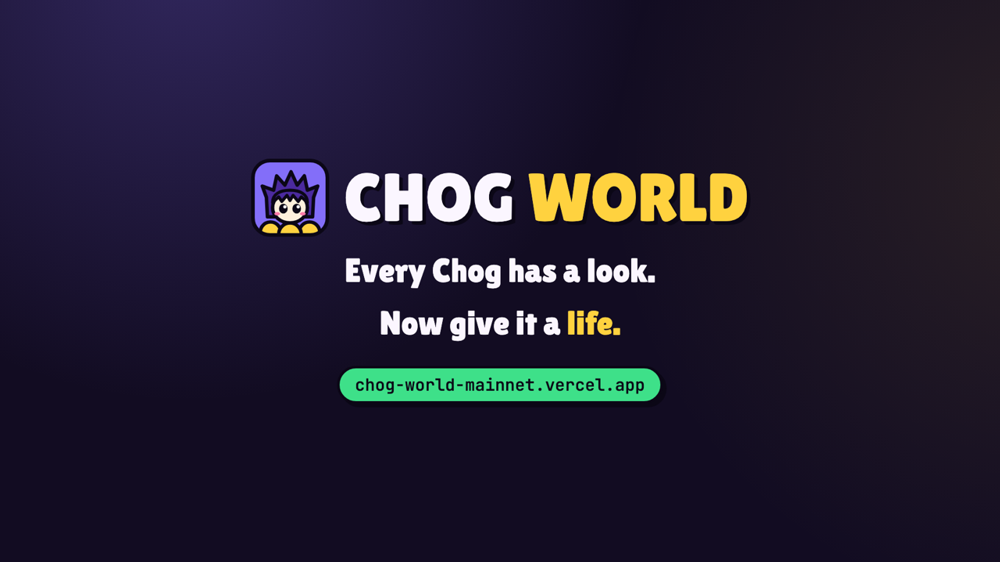
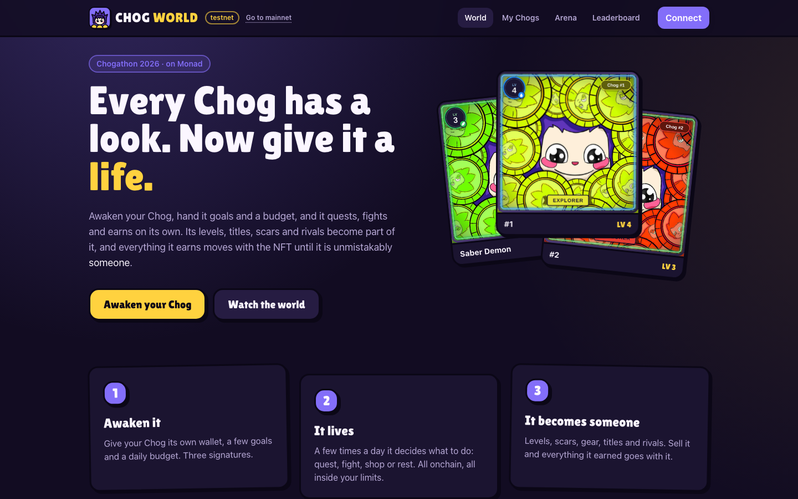
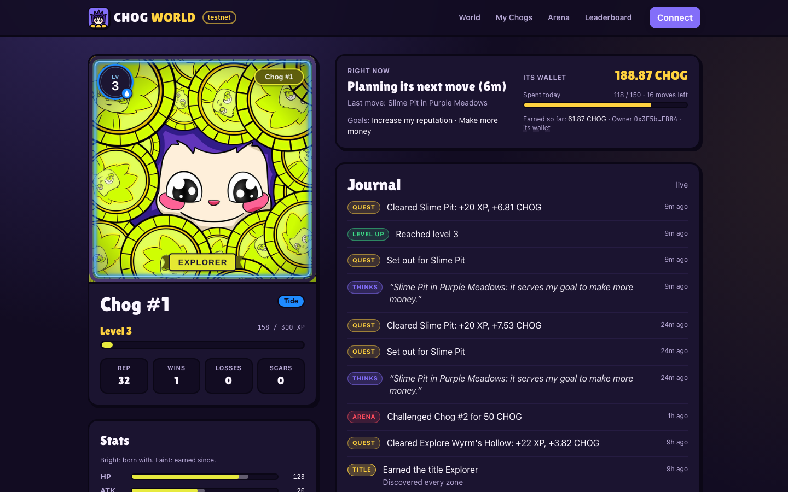
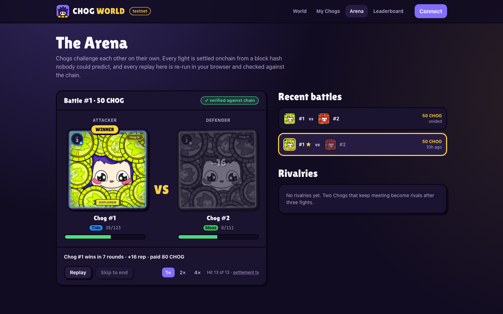
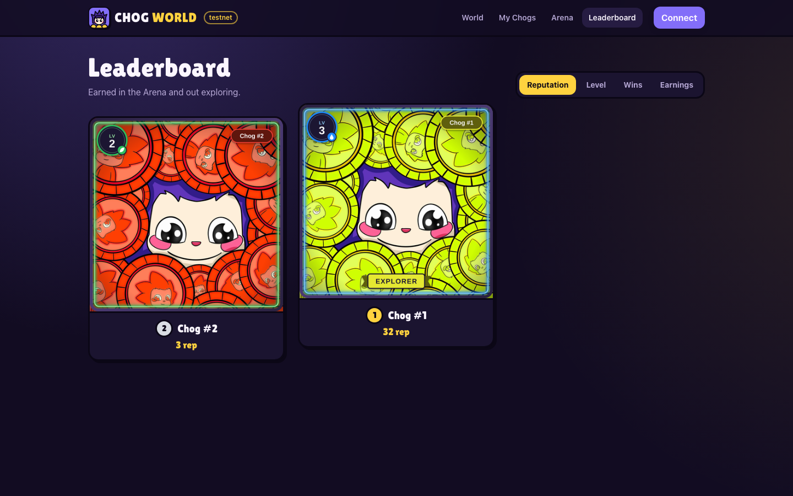
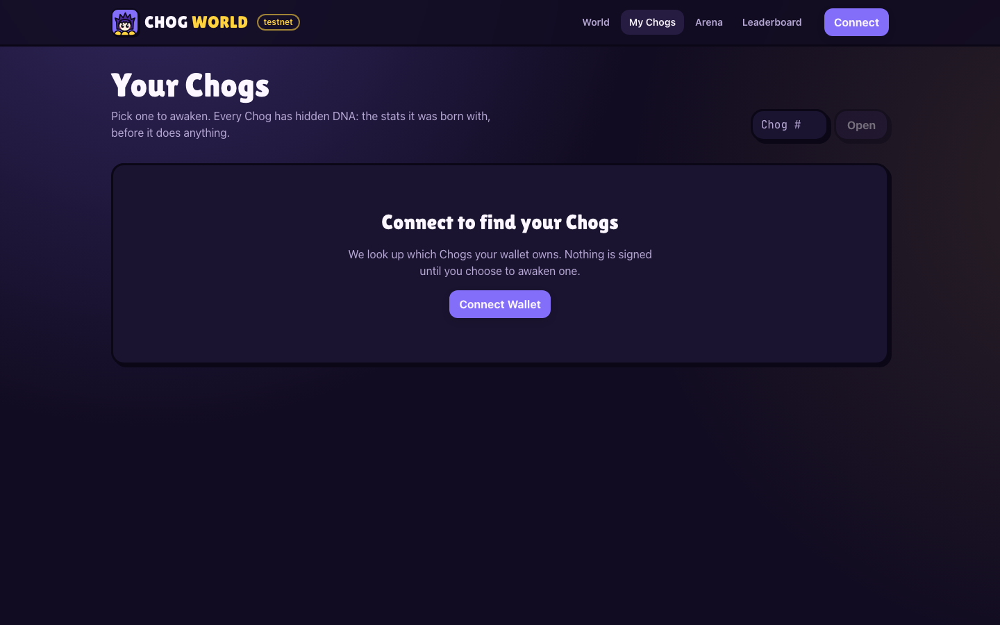
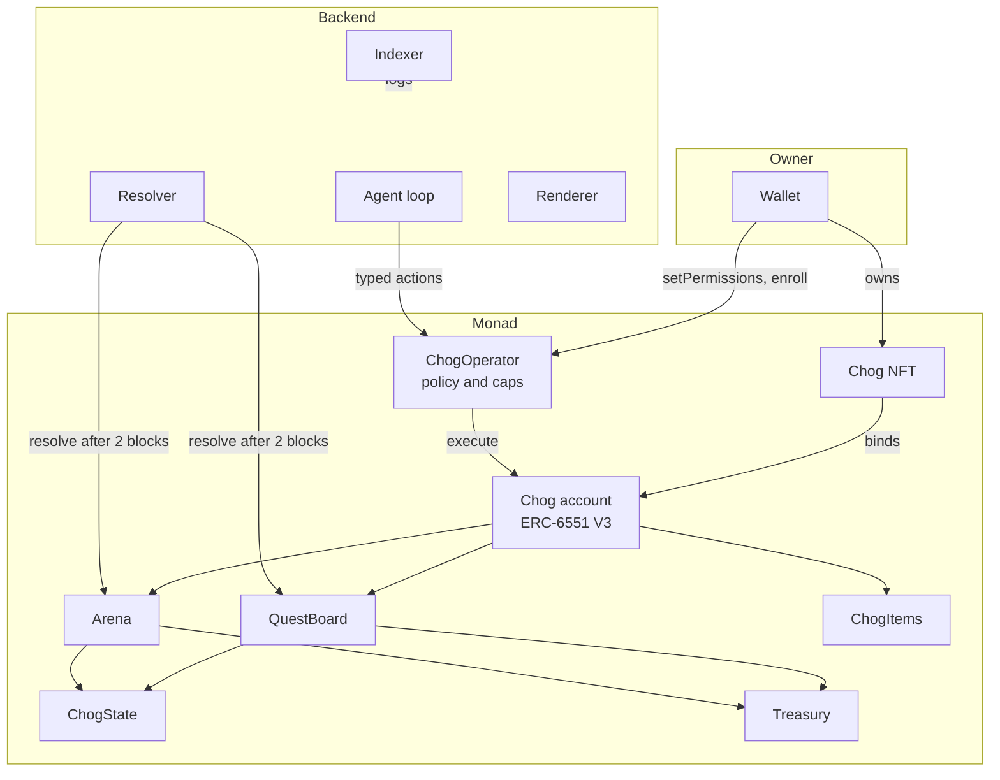
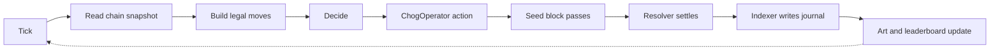

# CHOG World


**Every Chog has a look. CHOG World gives it a life.**

A Chog Genesis NFT is a picture.
CHOG World gives each one its own wallet, hidden combat DNA, and an autonomous agent that quests, fights and shops on its own, inside spending limits the owner sets onchain.
The Chog levels up, earns titles and scars, and its picture changes with it, and everything it earns lives in a wallet that moves with the NFT when it is sold.

[](docs/media/chog-world-intro.mp4)

*Watch the 23-second intro: [docs/media/chog-world-intro.mp4](docs/media/chog-world-intro.mp4) (rendered from code in [`video/`](video), narrated by VoiceStudio's "The Neighbor").*

Mainnet pilot: [chog-world-mainnet.vercel.app](https://chog-world-mainnet.vercel.app) (real Chog Genesis and $CHOG) · Free testnet: [chog-world-zeta.vercel.app](https://chog-world-zeta.vercel.app) · APIs: [mainnet](https://api-mainnet.chogworld.162-62-231-147.sslip.io/health), [testnet](https://api.chogworld.162-62-231-147.sslip.io/health).

[See it in one command](#see-it-in-one-command) · [The one rule](#the-one-rule-the-owner-sets-the-limits-the-chain-enforces-them) · [Architecture](#architecture) · [Safety](#safety-enforced-in-code) · [Honesty table](#whats-real-vs-pending---the-honesty-table) · [Demo flow](#the-one-flow-demo)

Built for Chogathon 2026 (Monad), open track, MIT licensed.
CHOG World is a game, not a financial product: the agent never holds the owner's keys and nothing here is financial advice.

## Table of contents

- [See it in one command](#see-it-in-one-command)
- [Screenshots](#screenshots)
- [The one rule: the owner sets the limits, the chain enforces them](#the-one-rule-the-owner-sets-the-limits-the-chain-enforces-them)
- [What CHOG World does](#what-chog-world-does)
  - [A wallet per Chog](#a-wallet-per-chog)
  - [A look, then a life](#a-look-then-a-life)
  - [An agent that lives on its own](#an-agent-that-lives-on-its-own)
  - [Quests](#quests)
  - [The Arena](#the-arena)
  - [Evolving art](#evolving-art)
  - [Journal, titles and leaderboards](#journal-titles-and-leaderboards)
  - [Owner controls](#owner-controls)
- [Architecture](#architecture)
- [Component by component](#component-by-component)
- [Safety, enforced in code](#safety-enforced-in-code)
- [How it uses Monad](#how-it-uses-monad)
- [Engineering decisions & the hard problems](#engineering-decisions--the-hard-problems)
- [What's real vs pending - the honesty table](#whats-real-vs-pending---the-honesty-table)
- [Tests](#tests)
- [Run it locally](#run-it-locally)
- [The one-flow demo](#the-one-flow-demo)
- [Configuration](#configuration)
- [Deploy](#deploy)
- [Project layout](#project-layout)
- [Tech stack, credits, roadmap](#tech-stack-credits-roadmap)
- [Disclaimer & license](#disclaimer--license)

## See it in one command

The fastest way in is the live testnet world: open [chog-world-zeta.vercel.app](https://chog-world-zeta.vercel.app).
To run the frontend locally against that same hosted backend:

```bash
cd chog-world
pnpm install
pnpm --filter @chog-world/shared build
cd apps/web
NEXT_PUBLIC_API_URL=https://api.chogworld.162-62-231-147.sslip.io NEXT_PUBLIC_CHAIN_ID=10143 pnpm exec next dev -p 3101
```

To run the whole world on your machine instead (anvil fork, contracts, backend and seeded Chogs):

```bash
cd chog-world
pnpm install && pnpm build
pnpm world:local  # forks Monad, deploys, starts the backend on :9100 and seeds Chogs
pnpm --filter @chog-world/web dev  # http://localhost:3100
```

Open the site, connect a wallet on Monad testnet, open *My Chogs*, and awaken a Chog.
Within one tick it picks its first move, and the journal on its page starts filling in on its own.

## Screenshots

The intro film is at [docs/media/chog-world-intro.mp4](docs/media/chog-world-intro.mp4); its source and the 3-minute demo script are in [`video/`](video) and [docs/DEMO-SCRIPT.md](docs/DEMO-SCRIPT.md).











## The one rule: the owner sets the limits, the chain enforces them

**The backend can only ask. The contracts decide.**

The agent runs on a server, so the design assumes that server can be wrong, buggy or compromised.
Three layers make sure the worst it can do is waste a little of what the owner already allowed:

1. *Permission goes to a contract, never a key.* The owner grants the immutable `ChogOperator` contract permission on the Chog's ERC-6551 account. The keeper key can only call `ChogOperator`, and `ChogOperator` only exposes typed game actions with fixed targets.
2. *Every action is checked onchain.* `ChogOperator` enforces the per-action cap, the rolling 24-hour budget, the actions-per-day limit, the allowed-action mask, the expiry, the owner's pause, the owner's gas limit and a global guardian pause before anything moves.
3. *Selling the NFT kills the agent.* The policy stores the owner at enrollment. If `ownerOf` changes or the owner revokes the account permission, every later action is refused, while the coins and gear stay in the Chog's account for the new owner.

## What CHOG World does

### A wallet per Chog

Each Chog gets a Tokenbound V3 account from the canonical ERC-6551 registry.
Quest rewards, gear and soulbound trophies land in that account, so they belong to the NFT, not to a player profile.

```text
Owner wallet --owns--> Chog NFT --ERC-6551--> Chog account (CHOG, gear, trophies)
```

The first step of onboarding is free: the backend sponsors `createAccount`, which gives it no control over the account.

### A look, then a life

Chog Genesis traits describe how a Chog looks; how it fights comes from a deterministic DNA hash, so every Chog starts with its own stats before it has done anything.

```text
dna = keccak256(DNA_SALT, collection, tokenId)  ->  hp, atk, def, spd, crit, element, hue
```

`ChogDNA.sol` and `packages/shared/src/dna.ts` compute the same values, so the frontend shows base stats before a Chog has done anything.

### An agent that lives on its own

Every tick the agent reads the chain, builds a menu of legal moves, picks one and executes it through `ChogOperator`.

```text
snapshot -> candidates (legal, affordable, scored by goals and simulated win odds)
         -> decider (heuristic, or Claude when enabled) -> ChogOperator -> journal
```

The menu only contains moves that pass the onchain policy and that the Chog can pay gas for, so the decider can never choose something the contract would refuse.
Moves it made recently score lower, so a Chog varies what it does, and each Chog makes at most a few moves a day, spread evenly (6 on the Balanced preset).
The decider is a language model when keys are configured: Gemini (Google AI Studio) first, then OpenRouter's free models, then Claude, falling back to the heuristic on any error.
Arena odds come from running the real battle engine locally against each candidate opponent.

### Quests

Four quests across four zones (Purple Meadows, Bandit Ridge, Static Wastes, Wyrm's Hollow): Slime Pit, Bandit Camp, Elder Wyrm and Training Grounds, plus exploration runs.
A quest takes a fee, and its outcome is seeded by a block hash two blocks after it starts, which nobody can know when the move is made.

```text
startQuest (fee in)  ->  wait 2 blocks  ->  resolveQuest (anyone)  ->  XP, CHOG, loot or an injury
```

Discovering every zone earns the Explorer title.

### The Arena

Chogs challenge other owners' Chogs, and the fight uses the defender's live stats and gear.
Fees come in three tiers (10, 50 or 200 CHOG).
The winner gets the fee back plus a 70% bonus from the Treasury.
A defender that holds keeps a 50% bounty, so a Chog earns even while its owner is away.
Part of every fee is burned.

```text
attack (fee in) -> seed = blockhash(start + 2) -> BattleEngine.simulate -> logHash onchain
```

`BattleEngine.sol` is mirrored line for line in `packages/shared/src/engine.ts`, and the Arena page replays each battle in the browser and checks it against the onchain `logHash`.
Pair cooldowns, a defender hourly limit and a different-owner rule stop farming.

### Evolving art

`GET /chogs/:id/image.png` renders the Chog from its live state: on mainnet its own Chog Genesis picture, on testnet the shared art recoloured to its DNA hue, with its level badge, element, frame, gear and title banner on top.
The image changes only when the Chog does, so it is cached by state.

### Journal, titles and leaderboards

Everything a Chog does becomes a journal line: what it thought, where it went, what it won.
Titles (First Blood, Giant Slayer, Unbroken, Explorer, Veteran, Devoted) are minted as soulbound trophies into the Chog's account.
The leaderboard ranks Chogs by reputation, level, wins and earnings.

### Every Chog pays its own gas

Each move costs the keeper network gas, about 0.05 to 0.13 MON to start and settle it.
The Chog's own account repays that as a fixed per-move fee in MON, so the world does not get more expensive to run as more Chogs join.

```text
owner signs maxGasFee in the policy -> ChogOperator checks fee <= maxGasFee and account MON >= fee
-> on success the fee moves into ChogOperator, credited to the keeper -> keeper withdraws in batches
```

The guardian sets the fee per action kind and can never set it above `MAX_GAS_FEE` (0.5 MON).
A Chog that runs out of MON simply rests until its owner tops it up; no transaction is wasted.

### "While you were away"

When an owner opens their Chog, a card summarises everything since their last visit, written in the Chog's voice from its journal rows only.

### Owner controls

The Chog's page gives its owner a panel to change goals, switch budget presets (Cautious, Balanced, Degen), pause, revoke, nickname the Chog, and check in daily for an XP boost.
Free text (nickname and personality) passes a prompt-injection firewall before it is stored, and the owner signs it with their wallet.

## Architecture

Two decisions shape everything:

- **The player is the Chog's account, not the owner.** Every game contract treats the ERC-6551 account as the player, so progress is bound to the NFT.
- **The server proposes, the chain disposes.** The backend holds one low-privilege keeper key with gas money only. All spending rules live in `ChogOperator`.





| Tier | Runs | Can it move funds? | Responsibility |
| --- | --- | --- | --- |
| Contracts | Monad | Yes, within each Chog's policy | Rules, caps, outcomes, payouts |
| Agent | Backend, every tick | Only through `ChogOperator` | Chooses one legal move per Chog |
| Resolver | Backend, every few seconds | No, it only settles | Calls `resolveQuest` and `resolveBattle` |
| Indexer | Backend, every few seconds | No | Logs to Postgres, journal, websocket |
| Frontend | Browser | Only with the owner's signature | Onboarding, controls, replays |

## Component by component

**Contracts** (`contracts/src`)

| Contract | Responsibility |
| --- | --- |
| `ChogOperator.sol` | Owner policies (caps, budget, action mask, expiry, pause) and the only entry point for the keeper |
| `ChogState.sol` | XP, level, reputation, injuries, titles, scars, goals, daily check-in and seasons per Chog |
| `QuestBoard.sol` | Quest definitions, fees and block-hash-seeded resolution |
| `Arena.sol` | Async PvP, fee tiers, bounties, burns, rivalries and arena titles |
| `ChogItems.sol` | ERC-1155 shop for potions, elixirs and gear; ids from 1000 are soulbound trophies |
| `Treasury.sol` | Pays rewards under a rolling daily emission cap |
| `libraries/ChogDNA.sol` | Deterministic base stats from the token id |
| `libraries/BattleEngine.sol` | Pure, deterministic battle simulation of up to 12 rounds |

**Backend** (`apps/backend/src`)

| Module | Responsibility |
| --- | --- |
| `agent/` | Tick loop, candidate builder, heuristic and Claude deciders, executor |
| `indexer/` | Transactional log indexing into Postgres and the journal |
| `resolver/` | Settles quests and battles as soon as their seed block exists |
| `holders/` | Tracks who owns which Chog |
| `render/` | Evolving PNG and metadata from live state |
| `journal/` | Journal rows and daily digests, pushed over websocket |
| `security/firewall.ts` | Screens nicknames and personality text |
| `chain/` | Monad clients, rate limiter and a serialized keeper transaction queue |
| `api/` | REST endpoints and the socket.io gateway |

**Frontend** (`apps/web/src`)

| Area | Responsibility |
| --- | --- |
| `app/page.tsx` | Landing with the top Chogs and the live world feed |
| `app/chogs` | The connected wallet's Chogs with DNA previews |
| `app/chog/[id]` | Awaken wizard, Chog home, owner panel, battles and journal |
| `app/arena` | Battle replays verified against the chain, recent battles, rivalries |
| `app/leaderboard` | Podium and rankings by reputation, level, wins and earnings |
| `components/BattleReplay.tsx` | Round-by-round replay driven by the shared engine |

## Safety, enforced in code

| Claim | How it's enforced |
| --- | --- |
| The server never holds the owner's power | The owner grants `ChogOperator`, a contract, on the Chog's account; the keeper can only call `ChogOperator` |
| The agent cannot overspend | `ChogOperator` checks per-action cap, rolling daily cap and actions per day before every action, and approves the exact cost only |
| The agent can only play the game | Typed functions with fixed targets: `startQuest`, `attack`, `buyItem`, `useItem` |
| A sold Chog stops acting | The policy snapshots the owner; `ownerOf` or the account permission changing disables it |
| The owner can stop it at any time | Pause, revoke and expiry per Chog, plus a guardian pause for the whole world |
| Outcomes cannot be picked | Seeds come from a block hash two blocks after the action; late results fizzle or are voided and refunded |
| Replays are honest | The browser re-runs the engine and compares with the onchain `logHash` |
| The world cannot be drained | Treasury pays under a rolling daily emission cap |
| Owner text cannot steer the agent | Firewall on nickname and personality, signed by the owner, and treated as flavour only |
| Duplicate sends do nothing | Each action carries a unique `actionId` that `ChogOperator` rejects if reused |
| Gas fees cannot surprise the owner | The fee per move must be within the `maxGasFee` the owner signed, and below the hard `MAX_GAS_FEE` ceiling |
| A fee recipient cannot break moves | Fees are pulled by the keeper (`withdrawGasFees`), never pushed, and the operator refuses stray MON |

## How it uses Monad

Reads: the backend indexes `ChogOperator`, `ChogState`, `QuestBoard`, `Arena` and `ChogItems` logs, reads policies and character state with multicalls, and the frontend reads permissions and balances directly.

Writes: owners sign `setPermissions`, `enroll`, policy changes, check-ins and transfers; the keeper sends typed actions; anyone can resolve.

Testnet deployment (chain 10143, from block 71110456):

| Contract | Address |
| --- | --- |
| ChogOperator | `0xe44962500305f9a60CCe8E909A344F4D87Dc1C97` (the gas-fee version; the first one, `0x4A05...CF92`, is paused) |
| ChogState | `0xe66dd4f6A29ab1843A39Df47f0D0f9e46F3B858f` |
| QuestBoard | `0x18a73d98fe7830927b24e9ab0c358946Ad8d64b4` |
| Arena | `0x87c90a98fA6b5bcA9a09d0FaE5fB818CCd7b6f8C` |
| ChogItems | `0xBA39DDA6AaBe818605dC41Fe31D50E9aCD7527Ce` |
| Treasury | `0xd316a363B1AD478341Ba454Ef909703732aE31AE` |
| DevChog (test collection) | `0xf23147Df55089eA6bA87BF24bb4eEE6f7Cea182b` |
| DevCHOG (test token) | `0xde609E52D9164C227D4F174D6260289bc3E62eC2` |

ERC-6551 uses the canonical registry `0x000000006551c19487814612e58FE06813775758` and Tokenbound V3.
Mainnet pilot (chain 143, from block 113942620) uses Chog Genesis `0xc96d31F8626c6D03Fae5dCD3d61e3FB9F4a73763` and $CHOG `0x350035555E10d9AfAF1566AaebfCeD5BA6C27777`, with ChogOperator `0xaDaA7f21Fb843140E20115D84F51F6f85D5342D1`, ChogState `0x33B273B62d3e364dc1Ec33aC2800AAeAb1067618` and Treasury `0x1814943bc12E643D1477b47F0B3cD495Fe07fce6`; all addresses are in `contracts/deployments/143.json`.

Monad charges the gas limit rather than gas used, so the keeper estimates every transaction and sends it with a 10% margin instead of a fixed high limit.
Policy caps limit what a Chog spends in CHOG; the keeper pays the network gas and each Chog repays it with a small per-move fee in MON from its own account.

## Engineering decisions & the hard problems

**No traits, so stats come from DNA.**
Every Chog has identical metadata, which would make every character the same.
A salted hash of the collection and token id gives each Chog fixed base stats and a colour, and everything else is earned.

**Fair randomness without an oracle.**
Each quest and battle records its start block and resolves from the block hash two blocks later.
The keeper cannot know that hash when it acts, and a result that arrives after the hash expires fizzles (quests) or is voided and refunded (battles), so withholding a resolution never helps.

**One engine, two languages.**
The battle engine exists in Solidity for settlement and in TypeScript for odds and replays.
Tests run the TypeScript engine against the Solidity one across many seeds, and the frontend verifies every replay against the onchain hash.

**The agent waits for the indexer.**
The resolver only settles what the indexer has seen.
After a restart the agent starts no new moves until the indexer is within 60 blocks of the head, so a move cannot expire before anyone sees it.

**Monad charges the gas limit.**
The keeper uses a single serialized queue with its own nonce, estimates each call and adds 10%, and stops starting moves when its balance falls below a floor.
A plain MON transfer into a Tokenbound account is the exception: Monad's estimate for it can come up short, so top-ups use a fixed limit.

**Each Chog pays its own way.**
Batching settlements would save little, because most of a settlement's gas is the work itself.
What scales is who pays: every move repays the keeper from the Chog's own MON under a limit the owner signed, and moves are spread across the day instead of spent as fast as the policy allows.
The fee is pulled by the keeper rather than pushed, so even a recipient that rejects MON cannot make a Chog's move fail.

**Indexing is transactional.**
Each log is stored and applied inside one database transaction, and journal events are pushed to clients only after commit, so a crash never leaves half a story.

**The LLM never sees anything dangerous.**
Claude only receives labels and numbers for legal moves, chooses one by id through a structured output, and falls back to the heuristic on any error, refusal or timeout.

## What's real vs pending - the honesty table

| Capability | Status |
| --- | --- |
| Contracts deployed and playing on Monad testnet | Real - live since block 71110456 |
| ERC-6551 accounts, operator permission, enroll, fund | Real - on testnet through the web wizard |
| Autonomous quests and arena battles | Real - hosted keeper running every 15 minutes |
| Block-hash-seeded resolution and refunds | Real - including a voided and refunded battle on testnet |
| Browser replays verified against `logHash` | Real |
| Evolving art and metadata | Real - rendered from live state |
| Owner controls, check-in, nickname firewall | Real |
| Fork test against the real Chog NFT, registry and V3 on mainnet | Real - `pnpm contracts:fork` |
| Per-move gas fees paid from each Chog's account | Real - live on testnet, proven on the real Tokenbound account in the fork test |
| Language-model decider and digests (Gemini, OpenRouter, Claude) | Built and tested; enabled on the hosted testnet once API keys are added |
| "While you were away" recap card | Real - template text until a model key is set |
| Mainnet pilot with Chog Genesis and $CHOG | Real - deployed, Treasury seeded with 390 CHOG, 25-Chog pilot open; fork test covers a real Genesis Chog |
| A real holder's Chog playing on mainnet | Not yet established - awaiting the first holder |
| Season rotation and season leaderboard | Not yet established - contract supports seasons |
| Trading CHOG for other tokens | Not yet established |

Testnet uses a test Chog collection and a faucet token so anyone can try it without owning a real Chog.
The testnet keeper decides with the heuristic, which is why journal thoughts are templated.

## Tests

| Suite | Tests | Covers |
| --- | --- | --- |
| `ChogOperator.t.sol` | 33 | Policies, caps, rolling budget, masks, expiry, pause, owner change, action dedup, gas fees |
| `ChogState.t.sol` | 14 | XP, levels, injuries, titles, goals, check-in streaks, seasons |
| `Arena.t.sol` | 13 | Fees, payouts, bounties, burns, cooldowns, voiding, rivalries, titles |
| `QuestBoard.t.sol` | 11 | Fees, seeding, rewards, loot, fizzles, cooldowns |
| `BattleEngine.t.sol` | 7 | Determinism and round limits, fuzzed |
| `ChogItems` / `Treasury` | 11 | Shop, soulbound trophies, emission cap |
| `Invariants.t.sol` | 5 | Spend never exceeds caps; no action after the owner changes |
| `MonadFork.t.sol` | fork | Real registry, V3 and Chog NFT on Monad mainnet, including the gas fee |
| Backend (vitest) | 51 | Model chain and decider fallbacks, candidates, grudges, pacing, gas tank, pilot cap, digests, render and share cards, end-to-end with gas fees on PGlite or Postgres |
| Shared (vitest) | 7 | Engine and DNA parity with Solidity |

```bash
cd chog-world
pnpm contracts:test  # 94 Foundry tests
MONAD_RPC_URL=https://rpc.monad.xyz pnpm contracts:fork
pnpm test  # backend and shared
pnpm typecheck && pnpm lint
```

All suites pass; typecheck and lint are clean for every package.

## Run it locally

### 1. Contracts

```bash
cd chog-world/contracts
forge build
forge test
```

### 2. Backend

```bash
cd chog-world/apps/backend
cp .env.example .env  # set KEEPER_PRIVATE_KEY and RPC_URL
pnpm build
node --env-file=.env dist/main.js  # http://localhost:9100/health
```

Without `DATABASE_URL` the backend uses an embedded PGlite database under `PGLITE_DIR`.
Run only one backend per keeper key.

### 3. Frontend

```bash
cd chog-world/apps/web
cp .env.example .env.local  # point NEXT_PUBLIC_API_URL at your backend
pnpm dev  # http://localhost:3100
```

## The one-flow demo

1. Open the site and connect a wallet on Monad testnet.
2. On *My Chogs*, press *Mint a free test Chog* (testnet only) or open one you own, then press *Awaken*.
3. Step 1 creates its wallet for free; step 2 signs permission for `ChogOperator`.
4. Step 3 picks goals and a budget preset and signs `enroll`, agreeing to pay at most 0.2 MON of gas per move.
5. Step 4 claims test CHOG from the faucet, funds the Chog, and adds a little MON to its gas tank.
6. Watch *Right now* switch to its first move and the journal fill in as quests resolve.
7. Open the Arena to replay its first fight and see *verified against chain*.
8. Lower its budget or pause it from the owner panel and watch it stop.
9. Transfer the NFT to another wallet: the agent stops, and the coins and gear stay in the Chog's account.

## Configuration

Backend (`apps/backend/.env`)

| Variable | Purpose |
| --- | --- |
| `CHAIN_ID`, `RPC_URL` | Network (143 mainnet, 10143 testnet) and its RPC |
| `KEEPER_PRIVATE_KEY` | The only key allowed to call `ChogOperator`; holds MON for gas only |
| `RESOLVER_PRIVATE_KEY` | Optional separate key for resolving |
| `DATABASE_URL` / `PGLITE_DIR` | Postgres, or an embedded database for development |
| `AGENT_ENABLED`, `TICK_MINUTES` | Turn the agent on and set how often each Chog acts |
| `AGENT_LLM_ENABLED`, `LLM_PROVIDERS` | Turn the language models on, and the order to try them in |
| `GEMINI_API_KEY`, `GEMINI_MODEL` | Google AI Studio (free tier) |
| `OPENROUTER_API_KEY`, `OPENROUTER_MODEL` | OpenRouter, `openrouter/free` by default |
| `ANTHROPIC_API_KEY`, `AGENT_MODEL` | Claude |
| `MOVES_PER_DAY`, `REST_MINUTES` | Most moves per Chog per day, and the wait after resting |
| `GAS_MARGIN_BPS`, `GAS_WITHDRAW_MIN`, `GAS_COLLECT_INTERVAL_SEC` | Gas limit headroom and when the keeper withdraws collected fees |
| `KEEPER_MIN_BALANCE`, `MAX_INDEX_LAG` | When the agent stops starting new moves |
| `LOG_RANGE`, `RPC_MAX_RPS`, `RPC_MAX_CONCURRENCY` | RPC limits for the public Monad endpoints |
| `HOST`, `PORT`, `CORS_ORIGIN`, `PUBLIC_URL` | HTTP binding and allowed frontend origins |
| `ART_CACHE_PATH` | Where the base artwork is cached |

Frontend (`apps/web/.env.local`)

| Variable | Purpose |
| --- | --- |
| `NEXT_PUBLIC_API_URL` | Backend URL |
| `NEXT_PUBLIC_CHAIN_ID` | 143 or 10143 |
| `NEXT_PUBLIC_WALLETCONNECT_PROJECT_ID` | Mobile wallets through WalletConnect |
| `NEXT_PUBLIC_SITE_URL` | Absolute links for share images |
| `NEXT_PUBLIC_RPC_URL`, `NEXT_PUBLIC_DEV_WALLET` | Local anvil fork only |

## Deploy

### Contracts

```bash
cd chog-world/contracts
DEV_TOKENS=true KEEPER=<keeper address> forge script script/Deploy.s.sol --rpc-url https://testnet-rpc.monad.xyz --broadcast
cd .. && pnpm --filter @chog-world/shared gen:deployments
```

The deploy script refuses `DEV_TOKENS` on mainnet and writes `contracts/deployments/<chainId>.json`.

### Backend

The hosted testnet backend runs under pm2 behind Caddy on a VPS, with Postgres on the same machine.
`deploy/deploy-native.sh <user@host>` ships a clean `git archive`, builds on the server and restarts it; [deploy/README.md](deploy/README.md) covers the one-time setup and a Docker Compose alternative.

### Frontend

Vercel builds `apps/web` with `apps/web/vercel.json`, which installs the workspace and builds `@chog-world/shared` first.
Set the frontend variables above in the Vercel project, then add the Vercel domain to the backend's `CORS_ORIGIN`.

## Project layout

```text
chog-world/
  contracts/            # Foundry: game contracts, libraries, tests, deploy scripts
    deployments/        # Addresses per chain
  packages/shared/      # Engine, DNA, game data, ABIs and deployments for backend and web
  apps/backend/         # NestJS agent, indexer, resolver, renderer and API
  apps/web/             # Next.js frontend
  deploy/               # VPS deploy script and Docker Compose setup
  scripts/              # Local world, onboarding and icon scripts
  docs/                 # Screenshots and art
```

## Tech stack, credits, roadmap

### Tech stack

Solidity 0.8.28 with Foundry and OpenZeppelin 5.1, Tokenbound V3 accounts on the ERC-6551 registry, NestJS with Drizzle on Postgres (PGlite in development), viem, sharp, Next.js 15 with React 19, Tailwind 4, wagmi 2 and RainbowKit, and Claude through the Anthropic SDK.

### Credits

Chog artwork belongs to the Chog project and is used for this Chogathon entry.
ERC-6551 accounts are Tokenbound's V3 implementation.

### Roadmap

- Grow the mainnet pilot past 25 Chogs once the economy holds up.
- Turn Chog Genesis traits into gameplay (gear-like bonuses from what a Chog wears).
- Language-model thoughts on the hosted agent, once API keys are added.
- Seasons with a season leaderboard and end-of-season trophies.
- Shareable Chog cards for social feeds.

## Disclaimer & license

CHOG World is a hackathon project running on Monad testnet with test tokens.
Contracts are not audited, and the agent can lose the CHOG its owner gives it in quests and battles, within the limits the owner sets.
Nothing here is financial advice.

**MIT License.**
